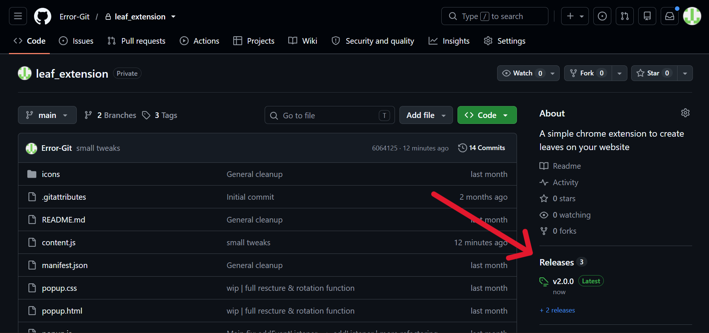
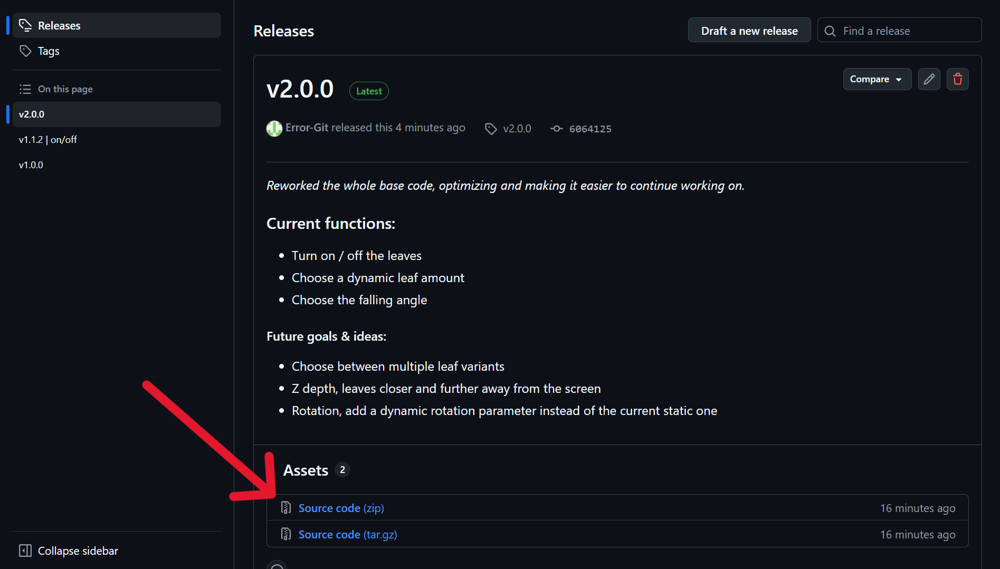
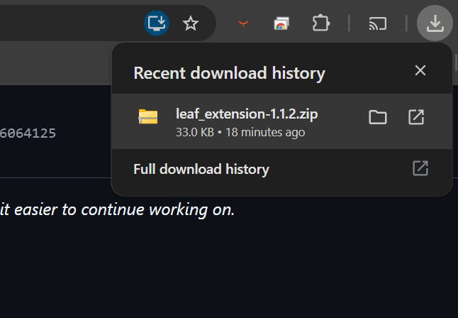
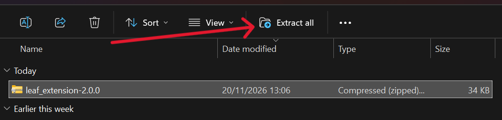
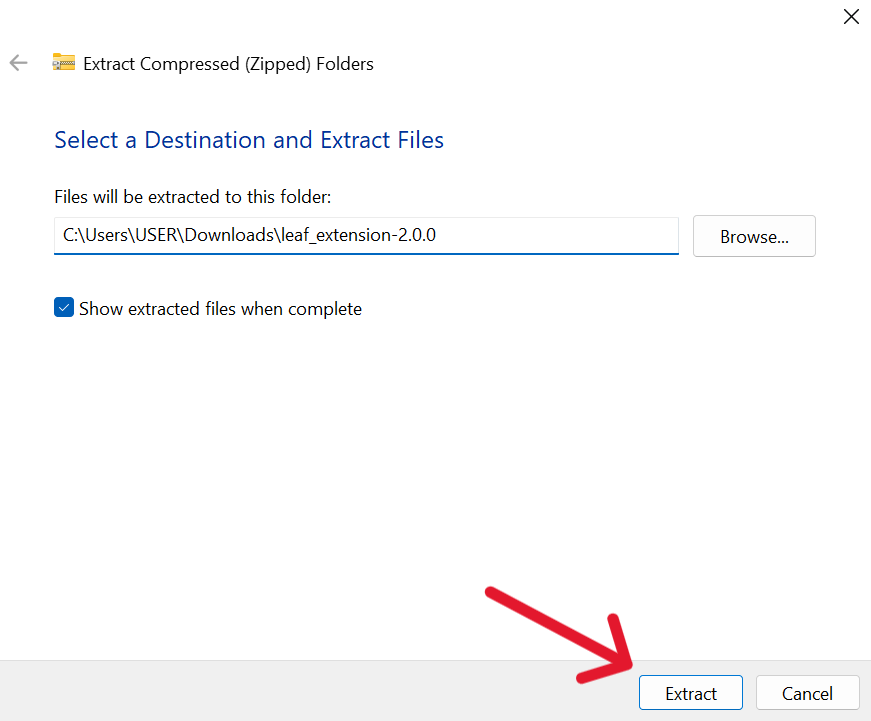
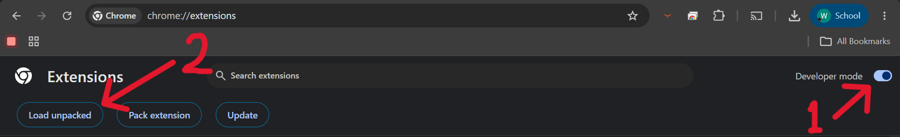
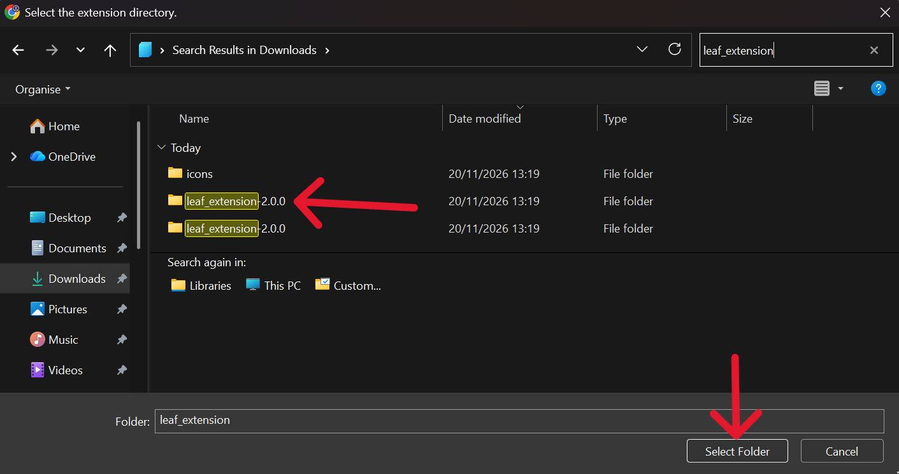
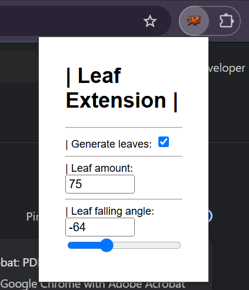

# Leaf Extension
A simple chrome extension to create leaves on your website

## Adding the extension to your browser

### 1. Releases

Click on **Releases**

### 2. Download source code

Click on the **Source code (zip)** to download the extension as a zip file

### 3. Extract zip

Open your download history and open the recently downloaded zip file:

With the zip file selected, click on **Extract all**:

Choose a destination for the extracted project, the standard folder works fine

### 4. Load extension

- Navigate to (chrome://extensions/)[chrome://extensions/]
- Turn on developer mode (1)
- Click on **Load unpacked** (2)

Select the **leaf_extension-X.X.X** folder, make sure to select the correct one as there might be 2, you should select the one not containing a folder with the same name, but the folder inside the folder in that case.

### 5. All done

Now you can access the leaf extension among the rest of your extension, feel free to play around with the settings.